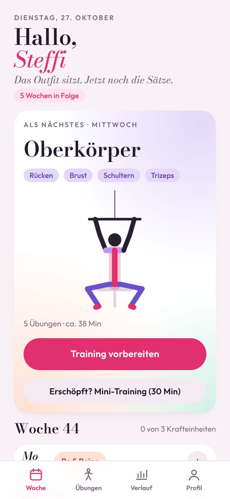
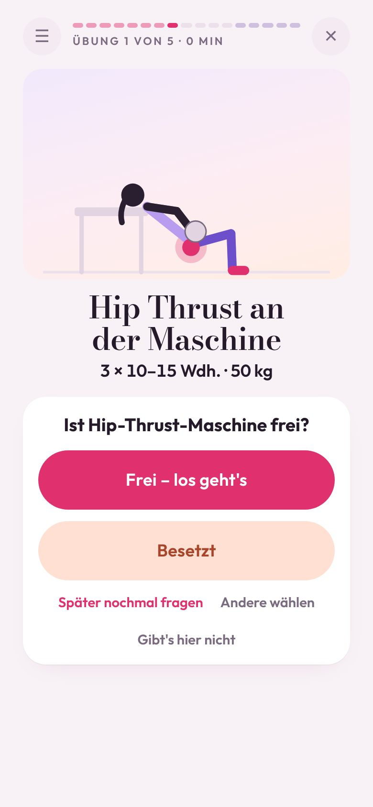
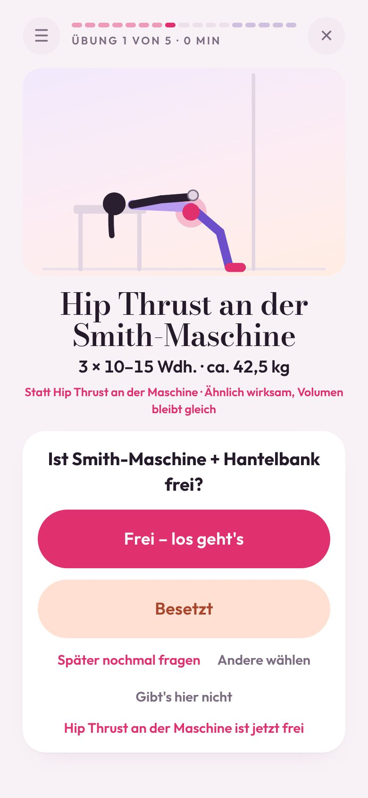
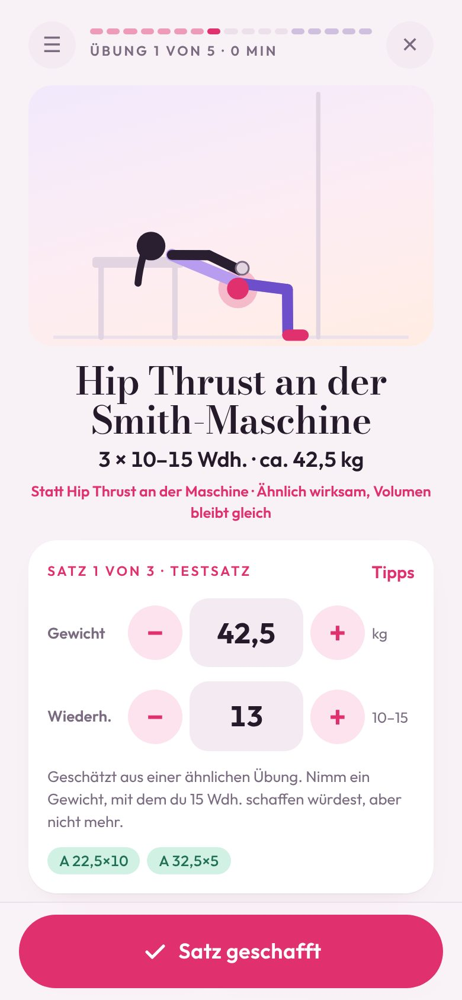
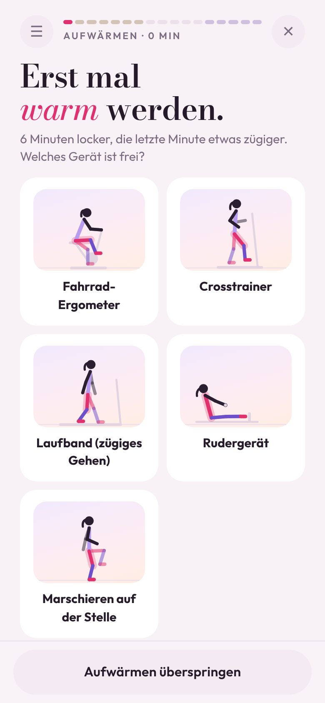
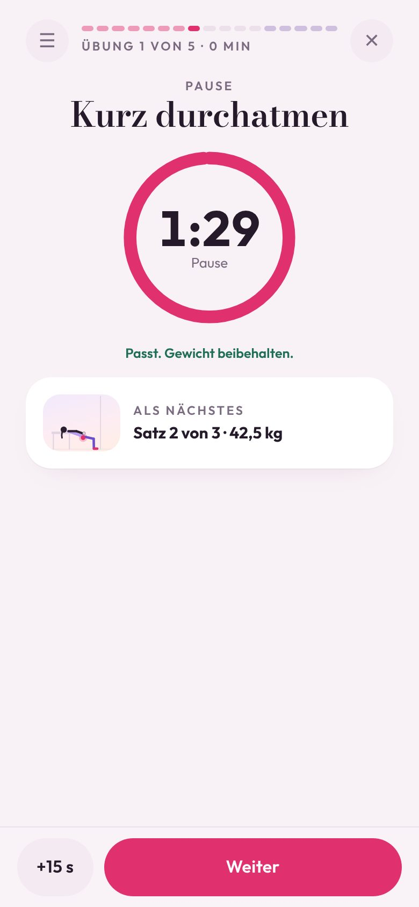
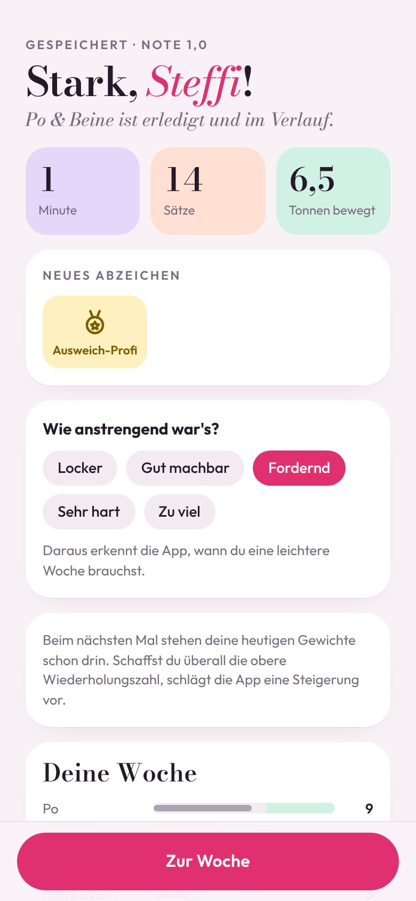
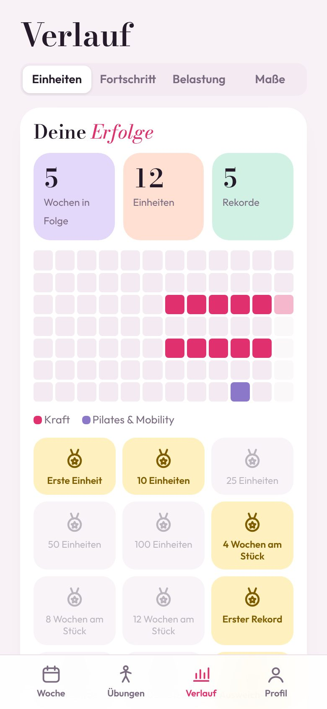

# Selfcare Studio

**Dein Training im Studio – ohne Nachdenken, auch wenn das Gerät besetzt ist.**

Selfcare Studio plant Krafttraining nach Muskelgruppen, fragt bei jeder Übung, ob das Gerät frei ist, und hat sofort eine Ausweichübung mit dem gleichen Trainingsreiz parat – Sätze, Wiederholungen und Gewicht passend umgerechnet. Dazu kommen geführtes Aufwärmen und Cool-down, Pilates und Mobility, ein Mini-Training für müde Tage und ein Verlauf, der zeigt, wie du stärker wirst.

Eine Web-App für den Home-Bildschirm: kein App Store, kein Konto, alle Daten bleiben auf dem Handy.

> **Neu hier?** Öffne die [Installationsanleitung](https://dnsmaur1992.github.io/Selfcare-Studio/installieren.html) auf deinem Handy – mit QR-Code und Schritt-für-Schritt-Hilfe für iPhone und Android.
>
> **Direkt zur App:** [dnsmaur1992.github.io/Selfcare-Studio](https://dnsmaur1992.github.io/Selfcare-Studio/)

---

## Inhalt

- [Screenshots](#screenshots)
- [Funktionen](#funktionen)
- [Installation](#installation)
- [Deine Daten](#deine-daten)
- [Updates veröffentlichen](#updates-veröffentlichen)
- [Aufbau des Repos](#aufbau-des-repos)
- [Technik](#technik)
- [Hinweise](#hinweise)

---

## Screenshots

<table>
  <tr>
    <td align="center"><br><sub><b>Woche</b> – nächste Einheit, Serie, Tagesplan</sub></td>
    <td align="center"><br><sub><b>Gerät frei?</b> – eine Frage, zwei Knöpfe</sub></td>
    <td align="center"><br><sub><b>Besetzt</b> – Ersatz mit gleichem Reiz</sub></td>
    <td align="center"><br><sub><b>Sätze</b> – Gewicht geschätzt, Testsatz</sub></td>
  </tr>
  <tr>
    <td align="center"><br><sub><b>Aufwärmen</b> – Cardio nach freiem Gerät</sub></td>
    <td align="center"><br><sub><b>Pause</b> – Ring, Gong, Ansage</sub></td>
    <td align="center"><br><sub><b>Abschluss</b> – Rekorde, Abzeichen, Anstrengung</sub></td>
    <td align="center"><br><sub><b>Verlauf</b> – Serie, Kalender, Abzeichen</sub></td>
  </tr>
</table>

---

## Funktionen

### Plan, der zu dir passt
- **Geführte Einrichtung** in fünf Schritten: Name und Outfit, Ziel, Häufigkeit, Wochenplan, „So läuft dein Training“
- **Trainingstage frei wählbar**, jederzeit verschiebbar, in einer vollen Woche zusammenlegbar
- **Automatisch oder selbst gebaut:** Muskelgruppen wählen und die App sucht die Übungen aus – oder eigene Übungen mit Sätzen und Wiederholungen zusammenstellen
- **Ziel:** Muskelaufbau mit eher höheren Wiederholungen (Standard), klassischer Aufbau oder Kraftausdauer; optional einige schwerere Sätze für Knochen und Muskelerhalt
- **Rücksicht auf Einschränkungen:** Rücken, Knie, Schulter, Handgelenk
- **106 Kraftübungen** an über 30 Geräten und mit Kleingerät, dazu 36 Pilates-, Mobility-, Aufwärm- und Dehnübungen – alle mit Animation und Ausführungstipps, viele mit typischem Fehler

### Im Studio: eine Übung, ein Bildschirm
- **„Ist das Gerät frei?“** bei jeder Übung – bei Matte, Band und Ball fragt die App gar nicht erst
- **Besetzt?** Sofort eine Ersatzübung mit **gleichem Bewegungsmuster**, Sätze und Wiederholungen umgerechnet; bereits geschaffte Sätze zählen mit
- **Später nochmal fragen**, **Gibt's hier nicht** (Gerät wird ausgeblendet), **Original ist jetzt frei**
- **Gewicht:** letztes Gewicht vorausgefüllt; bei neuen Übungen geschätzt aus ähnlichen Übungen (Testsatz); nach jedem Satz ein Vorschlag für mehr oder weniger
- **Pausen im Vollbild** mit Ring, Gong und Sprachansage – über die laufende Musik
- **Die App lernt dein Studio:** Geräte, die zu bestimmten Zeiten oft besetzt sind, kommen dann später dran
- **♪-Knopf** öffnet deine Playlist

### Aufwärmen und Cool-down
- **10–15 Minuten Aufwärmen:** Cardio am freien Gerät, Aktivierung passend zu den Muskelgruppen, zwei Aufwärmsätze
- **Mini-Training (30 Min, nur Körpergewicht)** für müde Tage – mit 5 Minuten Mobilisation passend zum Alltag: viel gesessen, viel gestanden, viel gehoben
- **Cool-down:** Dehnen der trainierten Muskeln mit Timer
- **Pilates und Mobility** als eigene 30-Minuten-Einheiten, frei in der Woche planbar

### Belastung und Alltag
- **Anstrengung nach jeder Einheit** mit einem Tipp
- **Entlastungswochen** automatisch – geplant oder wenn die letzten Einheiten sehr hart waren
- **Sanfter Wiedereinstieg** nach einer Pause
- **Wochen-Check-in** (entspannt / normal / stressig) und **Tagesform** (Schlaf, Energie) machen schwere Tage leichter
- **Wochenvolumen:** effektive Sätze pro Muskelgruppe mit Zielbereich

### Fortschritt und Erfolge
- Verlauf jeder Einheit mit allen Sätzen, Fortschritt pro Übung als Diagramm
- **Wochenserie, Rekorde, 15 Abzeichen**, Trainingskalender der letzten 12 Wochen
- **Körpermaße** (Taille, Hüfte, Po, Oberschenkel) mit Verlauf

### Persönlich
- **Gym-Outfit** für die Figur – fünf Vorlagen oder eigene Farben
- **Hell, Dunkel oder automatisch**
- **Trainingstage im iPhone-Kalender** als wiederkehrende Termine mit Erinnerung
- **Trainingstag teilen** per Link – die andere übernimmt ihn mit einem Tipp, ohne Server
- „Erste Schritte“ auf der Startseite und „Was ist neu“ nach jedem Update

---

## Installation

1. Den Link **in Safari** öffnen (nicht im WhatsApp- oder Instagram-Browser): [dnsmaur1992.github.io/Selfcare-Studio](https://dnsmaur1992.github.io/Selfcare-Studio/)
2. **Teilen-Symbol** antippen (bei neueren iPhones hinter den drei Punkten neben der Adresse)
3. **„Zum Home-Bildschirm“** wählen – fehlt der Eintrag: ganz unten „Aktionen bearbeiten“
4. **„Hinzufügen“** – ab jetzt immer über das Symbol starten

Android: Link in Chrome öffnen → Menü ⋮ → „App installieren“.

Ausführliche Anleitung mit QR-Code: [installieren.html](https://dnsmaur1992.github.io/Selfcare-Studio/installieren.html)

---

## Deine Daten

- Alles bleibt **nur auf dem Handy** (`localStorage`). Kein Konto, kein Server, keine Werbung, kein Tracking.
- Die installierte App speichert **getrennt vom Browser**.
- **Backup:** Profil → „Backup speichern“ sichert alles als Datei; „Backup laden“ stellt es wieder her – wichtig vor einem Handywechsel oder vor dem Neu-Installieren.
- Geteilte Trainingstage stecken komplett im Link; es wird nichts hochgeladen.

---

## Updates veröffentlichen

1. Neue Dateien ins Repo hochladen (gleichnamige werden überschrieben):
   - Hauptordner: `index.html`, `sw.js` – bei Bedarf `installieren.html`, `manifest.json`, Bilder
   - `docs/` und `tests/`, wenn sie sich geändert haben
2. Ein, zwei Minuten warten, bis GitHub Pages die neue Version ausliefert.
3. Die installierte App holt sich das Update im Hintergrund; sichtbar spätestens nach dem zweiten Öffnen. Die Versionsnummer steht unten im Profil.

---

## Aufbau des Repos

| Datei / Ordner | Inhalt |
|---|---|
| `index.html` | Die komplette App (HTML, CSS, JavaScript in einer Datei) |
| `sw.js` | Service Worker für Offline-Betrieb und Updates |
| `manifest.json` | App-Name, Farben, Symbole für den Home-Bildschirm |
| `installieren.html` | Installationsanleitung mit QR-Code |
| `icon-192.png`, `icon-512.png`, `apple-touch-icon.png` | App-Symbole |
| `og-image.jpg` | Vorschaubild für Links in WhatsApp & Co. |
| `docs/trainingslogik.md` | Wie die App rechnet: Plan, Ausweichen, Gewichte, Belastung |
| `docs/*.jpg` | Screenshots für diese Seite |
| `tests/logik.test.cjs` | Tests der Trainingslogik |
| `TODO.md` | Merkliste für die nächsten Versionen |

---

## Technik

- **Eine Datei, keine Abhängigkeiten:** reines HTML, CSS und JavaScript; Schriften von Google Fonts (Bodoni Moda, Outfit) mit Systemschrift als Rückfall
- **Animationen** als SVG-Strichfiguren mit inverser Kinematik, berechnet im Browser
- **Offline-fähig** über den Service Worker
- **Ton:** Web Audio für den Gong, Sprachausgabe des Systems für Ansagen; `audioSession` „transient“ (iOS 17+), damit Musik weiterläuft
- **Tests** ohne Browser:

  ```bash
  node tests/logik.test.cjs index.html
  ```

---

## Hinweise

- Selfcare Studio ersetzt **keine Trainerin und keine ärztliche Beratung**. Bei Schmerzen die Übung abbrechen; mit Beschwerden oder nach Verletzungen vorher ärztlich abklären.
- Gewichtsschätzungen für neue Übungen sind Richtwerte – der erste Satz ist ein Testsatz.
- Privates, nicht-kommerzielles Projekt.
